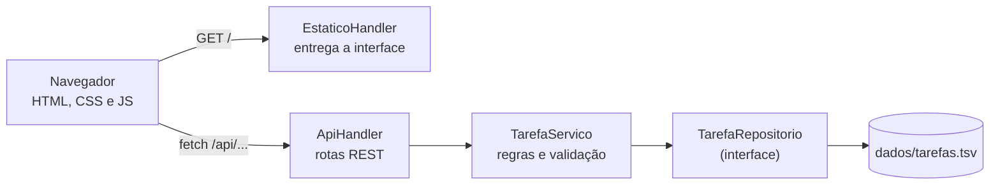

# Gerenciador de Tarefas

Sistema web para organizar tarefas em um quadro de três colunas (**A fazer**, **Em andamento** e **Concluída**).
O backend é feito em **Java puro**, sem frameworks nem bibliotecas externas, e a interface em **HTML, CSS e JavaScript**.


## Sumário

- [Funcionalidades](#funcionalidades)
- [Tecnologias](#tecnologias)
- [Como executar](#como-executar)
- [Como usar](#como-usar)
- [Como funciona](#como-funciona)
- [API REST](#api-rest)
- [Configuração](#configuração)
- [Estrutura do projeto](#estrutura-do-projeto)
- [Testes](#testes)
- [Segurança](#segurança)
- [Solução de problemas](#solução-de-problemas)
- [Limitações e próximos passos](#limitações-e-próximos-passos)

## Funcionalidades

- Criar, editar e excluir tarefas com título, descrição, prioridade, situação e prazo.
- Mover tarefas entre as colunas arrastando o cartão ou pelos botões **Iniciar**, **Concluir**, **Pausar** e **Reabrir**.
- Buscar por título ou descrição (sem diferenciar maiúsculas nem acentos) e filtrar por prioridade.
- Resumo no topo com a contagem por situação e uma barra de progresso.
- Destaque para tarefas **atrasadas** e que **vencem hoje**.
- Cartões ordenados por prioridade e, dentro dela, pelo prazo mais próximo.
- Dados salvos em arquivo: ao reiniciar o servidor, nada se perde.
- Interface responsiva (funciona no celular) e acessível por teclado e leitores de tela.

## Tecnologias

| Camada | Tecnologia |
|---|---|
| Backend | Java 17+, servidor HTTP embutido do JDK (`com.sun.net.httpserver`) |
| Persistência | Arquivo de texto (`dados/tarefas.tsv`) |
| Interface | HTML5, CSS3 e JavaScript puro (sem frameworks) |
| Testes | Testes de ponta a ponta em Java, sem JUnit |

O projeto não tem **nenhuma dependência externa**: só é preciso ter o JDK instalado.

## Como executar

### Pré-requisito

**JDK 17 ou superior.** Para conferir, rode `javac -version` no terminal.

### Linux e macOS

```bash
./executar.sh
```

### Windows

Dê dois cliques em `executar.bat` ou rode no terminal:

```bat
executar.bat
```

Depois abra **http://localhost:8080** no navegador. Para encerrar o servidor, pressione `Ctrl+C` no terminal.

> Para usar outra porta, informe-a no comando: `./executar.sh 9090`.

### Pelo IntelliJ IDEA

1. Em **File > Open**, escolha a pasta do projeto (o `pom.xml` é importado como projeto Maven, sem dependências).
2. Abra `src/main/java/com/gerenciador/Main.java` e clique em **Run**.

### Com Maven (opcional)

```bash
mvn package
java -jar target/gerenciador-tarefas-1.0.0.jar
```

### Compilação manual

Equivale ao que os scripts fazem:

```bash
mkdir out
javac -encoding UTF-8 -d out -sourcepath src/main/java src/main/java/com/gerenciador/Main.java
cp -r src/main/resources/. out/          # Windows: xcopy /e /i /y src\main\resources out
java -cp out com.gerenciador.Main
```

## Como usar

### Criar uma tarefa

1. Clique em **Nova tarefa**.
2. Preencha o **título** (obrigatório, até 100 caracteres). Os demais campos são opcionais:
   descrição (até 500 caracteres), prioridade, situação inicial e prazo.
3. Clique em **Salvar tarefa**. O cartão aparece na coluna escolhida.


### Mover uma tarefa

Há duas formas:

- **Arrastar e soltar**: segure o cartão e solte-o sobre outra coluna.
- **Botões do cartão**, que mudam conforme a coluna em que ele está:

| Coluna atual | Botões de movimento |
|---|---|
| A fazer | **Iniciar** (vai para Em andamento) |
| Em andamento | **Concluir** (vai para Concluída) e **Pausar** (volta para A fazer) |
| Concluída | **Reabrir** (volta para Em andamento) |

### Editar e excluir

- **Editar** abre o mesmo formulário com os dados atuais. Esvaziar a descrição ou o prazo remove o valor.
- **Excluir** pede confirmação antes de apagar. A ação não pode ser desfeita.

### Buscar e filtrar

- Digite na caixa de busca para procurar no título e na descrição. Buscar por `revisao` encontra "Revisão".
- Use o seletor **Prioridade** para ver só tarefas altas, médias ou baixas.
- Quando há filtro ativo, aparece o botão **Limpar filtros**.

### Entender o quadro

| Elemento | Significado |
|---|---|
| Barra lateral colorida do cartão | Prioridade: vermelha = alta, âmbar = média, cinza-azulada = baixa |
| Etiqueta "Prioridade alta/média/baixa" | Mesma informação em texto |
| "Venceu em dd/mm/aaaa" (vermelho) | Prazo já passou e a tarefa não está concluída |
| "Vence hoje" | O prazo é hoje |
| Título riscado | Tarefa concluída |
| Barra de progresso | Proporção entre A fazer (cinza), Em andamento (azul) e Concluídas (verde) |
| Frase abaixo de "Tarefas" | Total de tarefas, contagem por situação e quantas estão atrasadas |

A busca e o filtro afetam os cartões exibidos, mas o resumo e a barra de progresso sempre contam **todas** as tarefas.

### Teclado

`Tab` e `Shift+Tab` percorrem os campos e botões, `Enter` envia o formulário e `Esc` fecha o formulário sem salvar.

### No celular

Abaixo de 900 px de largura as colunas ficam empilhadas. Para abrir de outro aparelho da mesma rede, veja [Configuração](#configuração).


## Como funciona

### Visão geral

O navegador carrega a página (HTML, CSS e JS) e, a partir daí, o JavaScript conversa com o servidor por uma API REST que devolve JSON.
O servidor é organizado em camadas, cada uma com uma responsabilidade:



| Camada | Classe | Responsabilidade |
|---|---|---|
| Web | `ApiHandler` | Recebe a requisição, escolhe a rota e converte o resultado em JSON e códigos HTTP |
| Web | `EstaticoHandler` | Entrega `index.html`, CSS e JS lidos do classpath (funciona também dentro de um `.jar`) |
| Serviço | `TarefaServico` | Valida os dados, aplica filtros, ordena e calcula o resumo |
| Repositório | `ArquivoTarefaRepositorio` | Lê e grava as tarefas no arquivo |
| Modelo | `Tarefa`, `Prioridade`, `Status`, `Resumo` | Dados do domínio (`Tarefa` é imutável) |

### O caminho de uma ação

Exemplo: clicar em **Iniciar** em um cartão.

1. O JavaScript envia `PATCH /api/tarefas/3/status` com `status=EM_ANDAMENTO`.
2. O `ApiHandler` identifica a rota e chama `TarefaServico.mudarStatus`.
3. O serviço valida o status, busca a tarefa e cria uma cópia com a nova situação e a data de atualização.
4. O repositório grava a tarefa e reescreve o arquivo.
5. O servidor responde com a tarefa atualizada em JSON.
6. O JavaScript recarrega a lista e o resumo e redesenha o quadro.

### Regras de negócio

- **Título**: obrigatório, até 100 caracteres. Espaços repetidos viram um só.
- **Descrição**: opcional, até 500 caracteres.
- **Prioridade**: `BAIXA`, `MEDIA` ou `ALTA` (padrão `MEDIA`).
- **Situação**: `A_FAZER`, `EM_ANDAMENTO` ou `CONCLUIDA` (padrão `A_FAZER`).
- **Prazo**: opcional, no formato `AAAA-MM-DD`.
- **Atrasada**: tarefa com prazo anterior a hoje que ainda não foi concluída.
- **Ordem da lista**: prioridade (alta primeiro), depois prazo mais próximo (sem prazo por último), depois a mais antiga.

### Persistência

As tarefas ficam em memória e são gravadas em `dados/tarefas.tsv` a cada alteração. O arquivo tem uma tarefa por linha, com campos separados por TAB:

```
id  título  descrição  prioridade  situação  prazo  criadaEm  atualizadaEm
```

Pontos de cuidado:

- A gravação é feita em um arquivo temporário que depois substitui o original, então uma falha no meio nunca deixa o arquivo pela metade.
- Se a gravação falhar, a alteração em memória é desfeita e o erro é informado.
- Os caracteres `\`, TAB e quebra de linha dentro dos textos são protegidos, então qualquer conteúdo é salvo e lido sem perdas.
- Se o arquivo estiver corrompido, o servidor **não inicia** e informa a linha com problema, em vez de ignorar dados.
- Alterações são sincronizadas, então requisições simultâneas não geram ids repetidos nem perdem dados.

## API REST

A API recebe dados no formato de formulário (`application/x-www-form-urlencoded`) e responde sempre em JSON.

| Método | Rota | O que faz | Resposta |
|---|---|---|---|
| `GET` | `/api/tarefas` | Lista tarefas. Filtros opcionais: `q`, `prioridade`, `status` | `200` |
| `POST` | `/api/tarefas` | Cria uma tarefa (`titulo` obrigatório) | `201` + `Location` |
| `GET` | `/api/tarefas/{id}` | Busca uma tarefa | `200` |
| `PUT` | `/api/tarefas/{id}` | Atualiza a tarefa | `200` |
| `PATCH` | `/api/tarefas/{id}/status` | Muda só a situação (`status`) | `200` |
| `DELETE` | `/api/tarefas/{id}` | Exclui a tarefa | `204` |
| `GET` | `/api/resumo` | Contagens usadas no topo da tela | `200` |

Campos aceitos em `POST` e `PUT`: `titulo`, `descricao`, `prioridade`, `status` e `prazo`.
No `PUT`, título, descrição e prazo são sempre substituídos (descrição ou prazo em branco limpam o campo),
enquanto prioridade e situação em branco mantêm o valor atual.

### Exemplos

Criar uma tarefa:

```bash
curl -X POST -d "titulo=Estudar Java&prioridade=ALTA&prazo=2026-12-01" http://localhost:8080/api/tarefas
```

```json
{"id":8,"titulo":"Estudar Java","descricao":"","prioridade":"ALTA","status":"A_FAZER","prazo":"2026-12-01","atrasada":false,"criadaEm":"2026-11-07T02:06:31","atualizadaEm":"2026-11-07T02:06:31"}
```

Mover para "Em andamento":

```bash
curl -X PATCH -d "status=EM_ANDAMENTO" http://localhost:8080/api/tarefas/8/status
```

Buscar com filtros:

```bash
curl "http://localhost:8080/api/tarefas?q=teste&prioridade=MEDIA"
```

Consultar o resumo:

```bash
curl http://localhost:8080/api/resumo
```

```json
{"total":7,"aFazer":3,"emAndamento":2,"concluidas":2,"atrasadas":1}
```

Excluir:

```bash
curl -X DELETE http://localhost:8080/api/tarefas/8
```

### Erros

Todo erro volta como JSON, com o código HTTP correspondente:

```json
{"erro":"O título é obrigatório."}
```

| Código | Quando acontece |
|---|---|
| `400` | Dados inválidos (título vazio, prioridade ou status desconhecidos, data fora do formato, id inválido) |
| `404` | Tarefa ou rota inexistente |
| `405` | Método não permitido na rota (o cabeçalho `Allow` lista os permitidos) |
| `413` | Corpo da requisição maior que 64 KB |
| `500` | Erro interno (por exemplo, falha ao gravar o arquivo) |

## Configuração

| Item | Como alterar | Padrão |
|---|---|---|
| Porta | 1º argumento: `./executar.sh 9090` | `8080` |
| Endereço de escuta | 2º argumento: `./executar.sh 8080 0.0.0.0` | `127.0.0.1` (só esta máquina) |
| Arquivo de dados | Variável de ambiente `TAREFAS_ARQUIVO` | `dados/tarefas.tsv` |

Exemplo com arquivo de dados em outro lugar:

```bash
TAREFAS_ARQUIVO=/caminho/minhas-tarefas.tsv ./executar.sh        # Linux/macOS
set TAREFAS_ARQUIVO=C:\caminho\minhas-tarefas.tsv && executar.bat  # Windows (cmd)
```

> Usar `0.0.0.0` libera o acesso para outros aparelhos da rede, e o sistema **não tem login**. Faça isso apenas em redes confiáveis.

## Estrutura do projeto

```
gerenciador-tarefas/
├── README.md
├── pom.xml                         # opcional, para Maven e IntelliJ
├── executar.sh / executar.bat      # compilam e iniciam o sistema
├── testar.sh / testar.bat          # compilam e rodam os testes
├── docs/                           # imagens usadas neste README
└── src/
    ├── main/
    │   ├── java/com/gerenciador/
    │   │   ├── Main.java           # entrada: lê porta e host
    │   │   ├── Servidor.java       # monta o servidor HTTP
    │   │   ├── modelo/             # Tarefa, Prioridade, Status, Resumo
    │   │   ├── repositorio/        # TarefaRepositorio e ArquivoTarefaRepositorio
    │   │   ├── servico/            # TarefaServico, DadosTarefa e exceções
    │   │   └── web/                # ApiHandler, EstaticoHandler, Json, Formulario, Resposta
    │   └── resources/static/       # index.html, css/style.css, js/app.js, favicon.svg
    └── test/java/com/gerenciador/
        └── TestesApi.java          # testes de ponta a ponta
```

## Testes

```bash
./testar.sh      # Linux e macOS
testar.bat       # Windows
```

Os testes sobem o servidor real em uma porta livre, usam um arquivo de dados temporário e fazem requisições HTTP de verdade. Cobrem:

- entrega dos arquivos da interface e bloqueio de acesso a arquivos fora de `static/`;
- validação de todos os campos e mensagens de erro;
- criar, ler, atualizar, mover e excluir tarefas;
- busca sem acentos, filtros e ordenação;
- resumo e cálculo de tarefas atrasadas;
- métodos não permitidos, ids inválidos e corpo grande demais;
- 40 criações simultâneas sem ids repetidos;
- persistência após reiniciar, com acentos, emoji e quebras de linha;
- arquivo de dados corrompido.

A saída termina com o total de verificações e falhas, e o código de saída é diferente de zero se algo falhar.

## Segurança

- Por padrão o servidor só aceita conexões da própria máquina.
- A interface nunca insere texto do usuário como HTML (usa `textContent`), o que evita injeção de scripts (XSS).
- O cabeçalho `Content-Security-Policy` limita de onde a página pode carregar scripts e estilos.
- Só são entregues arquivos de `static/` com extensões conhecidas, e caminhos com `..` são recusados.
- O tamanho do corpo das requisições é limitado a 64 KB.

## Solução de problemas

| Problema | O que fazer |
|---|---|
| `javac` não é reconhecido | Instale o JDK 17 ou superior (não basta o JRE) e confira com `javac -version` |
| "A porta 8080 já está em uso" | Feche o programa que usa a porta ou inicie em outra: `./executar.sh 8081` |
| `Permission denied` ao rodar `executar.sh` | Rode `chmod +x executar.sh testar.sh` ou use `sh executar.sh` |
| "Arquivo de dados inválido na linha N" | O arquivo `dados/tarefas.tsv` foi alterado à mão. Corrija a linha indicada ou apague o arquivo |
| Página com "Não foi possível falar com o servidor" | O servidor não está rodando. Inicie-o de novo e recarregue a página |
| A fonte parece diferente da imagem | A página pede fontes ao Google Fonts. Sem internet ela usa as fontes do sistema, sem prejuízo ao uso |
| Quero começar do zero | Pare o servidor e apague `dados/tarefas.tsv` |

## Limitações e próximos passos

Limitações atuais:

- Não há login: o sistema é de um único usuário e pensado para uso local ou de estudo.
- Os dados ficam em um arquivo, o que serve bem para poucas centenas de tarefas.
- A lista não atualiza sozinha se outra pessoa alterar os dados em outro navegador; basta recarregar a página.

Ideias de evolução:

- Trocar o arquivo por MySQL, criando uma implementação de `TarefaRepositorio` com JDBC e alterando uma linha em `Servidor.java`.
- Adicionar login e tarefas por usuário.
- Categorias ou etiquetas e ordenação manual dentro das colunas.
- Migrar para Spring Boot mantendo as camadas de serviço e repositório.
